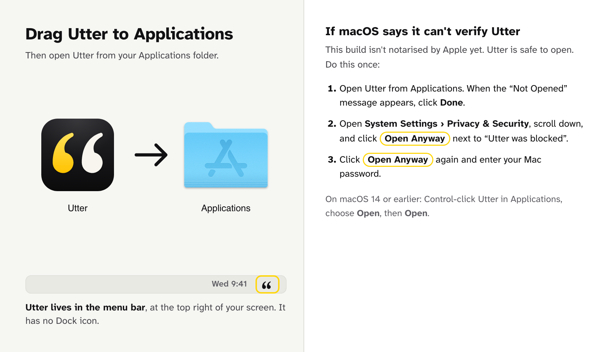
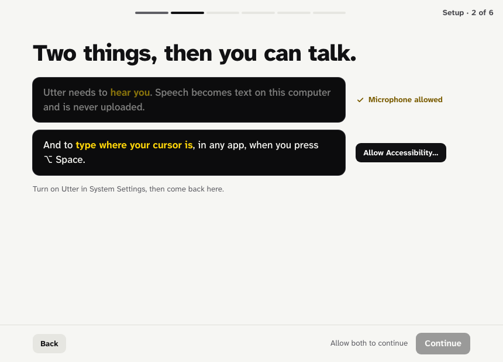
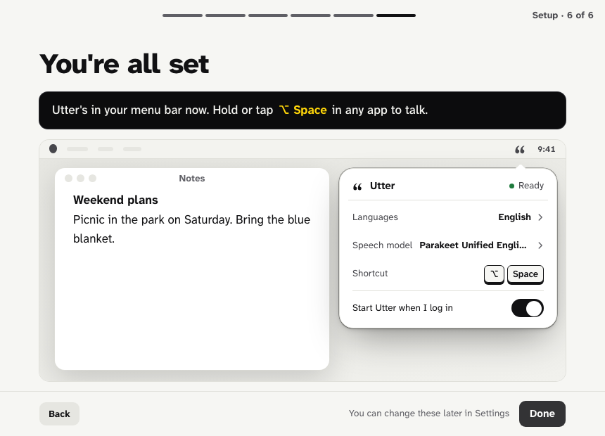
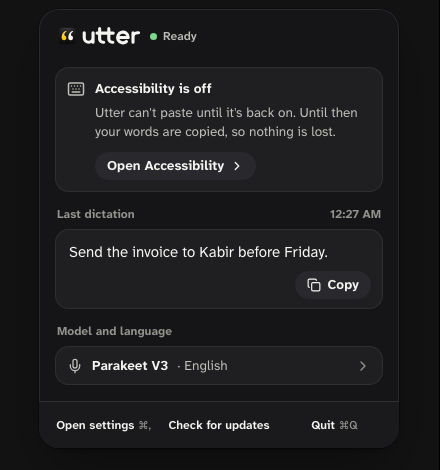
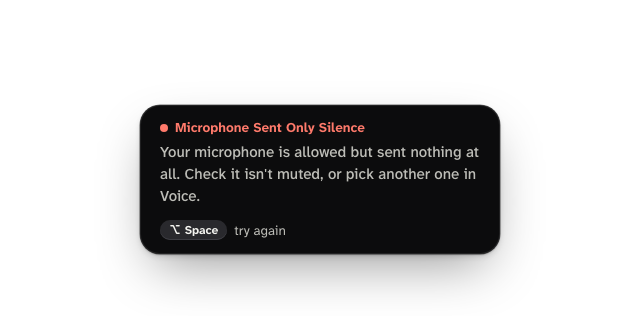

# Utter: downloads and updates

Utter turns what you say into text in whatever app you are using. Press
**Option+Space**, talk, and your words appear where your cursor was. Speech
recognition runs entirely on your Mac; AI is optional and only runs when you
ask for it.

This repository only hosts the installers and the update feed.

**[Download the latest version](https://github.com/mindbee-labs/utter-releases/releases/latest)**
· Macs with Apple silicon, macOS 13 or later

## Install

1. From the [latest release](https://github.com/mindbee-labs/utter-releases/releases/latest),
   download `Utter_<version>_aarch64.dmg`.
2. Open the DMG and drag **Utter** onto **Applications**.

   

3. Open **Utter** from your Applications folder. The first time, macOS stops
   it, because this build isn't notarised by Apple yet. Utter is safe to open;
   do this once:
   1. When the "Utter" Not Opened message appears, click **Done**.
   2. Open **System Settings › Privacy & Security**, scroll down, and click
      **Open Anyway** next to "Utter was blocked to protect your Mac".
   3. Click **Open Anyway** again and enter your Mac password.

   On macOS 14 or earlier you can instead Control-click Utter in Applications,
   choose **Open**, then **Open**.

4. Follow the setup. It asks for two permissions, then you pick a speech
   model and try a dictation:

   

## Utter lives in the menu bar

Utter has **no Dock icon** and no window once it is set up. Look for its icon
(two quotation marks) at the **top right of your screen**, in the menu bar.
Click it for the last dictation, the model and language, settings and
updates.



If you can't see it, your menu bar may be full: quit a few menu-bar apps, or
open Utter again from Applications to bring up its settings.

## Use

- **Hold Option+Space** while you speak and let go: the text is pasted.
- **Tap Option+Space**, speak, and stop talking: Utter stops after a short
  pause (2 seconds; change it in **Talk › Stop when I pause**) and pastes.
- **Escape** cancels a recording without pasting.
- Switch windows while you talk and Utter still pastes into the window you
  started in. If that window was closed, Utter copies the words instead:
  press ⌘V to paste them. Every dictation is also in **History**.

## Permissions

Utter asks for exactly two:

| Permission | Why |
|---|---|
| **Microphone** | To hear you. Speech becomes text on this Mac and is never uploaded. |
| **Accessibility** | To paste where your cursor is and to know which window you're talking into. |

Utter never asks for Screen Recording and never takes screenshots.

From 1.0.0 on, updates are signed with the same certificate, so your
permissions and saved AI keys carry over and you won't be asked again after an
update.

## Updates

Installed copies check this page and offer new versions themselves (menu bar
icon › **Check for updates**). Every update is signed with Utter's own key and
refused if the signature doesn't match.

## Troubleshooting

### "Utter can't paste" / "Copied. Accessibility is off"

Accessibility was turned off for Utter (or removed from the list). Utter then
copies your words instead of pasting them, so nothing is lost: press ⌘V. The
menu-bar panel shows **Open Accessibility**; turn Utter on there and it pastes
again. If the shortcut doesn't respond afterwards, quit and reopen Utter.



### "Microphone Sent Only Silence"

macOS lets Utter use the microphone, but the microphone sent nothing at all.
Usually it is muted, switched off, or the wrong input (a virtual device, or a
headset that isn't connected). Click **Choose microphone** in the menu-bar
panel, or pick another one in **Voice › Microphone**. Also check **System
Settings › Sound › Input** shows the level moving when you speak.



### "Microphone Access Denied"

Turn Utter on in **System Settings › Privacy & Security › Microphone**. The
menu-bar panel has a button that opens it.

### Start the permissions over

If a switch in System Settings looks on but Utter still can't paste or hear
you (for example after copying Utter from another Mac), reset its permissions
and allow them again:

1. Quit Utter (menu bar icon › **Quit**).
2. In Terminal, run:

   ```sh
   tccutil reset Accessibility com.mindbeelabs.utter
   tccutil reset Microphone com.mindbeelabs.utter
   ```

3. Open Utter again. It asks for both permissions, as in the first setup.

### The shortcut stopped working (Secure Input)

When another app turns on macOS **Secure Keyboard Entry**, apps like Utter
stop seeing the keyboard shortcut. Password fields do this while focused, and
some terminals (Ghostty, Terminal, iTerm2) turn it on by themselves when they
think a password is being typed. Utter shows a warning and falls back to a
system shortcut where it can.

To fix it, turn Secure Keyboard Entry off in the app that holds it:

- **Ghostty:** add `macos-auto-secure-input = false` to
  `~/.config/ghostty/config` and restart Ghostty (or turn it off from the
  Ghostty menu).
- **Terminal / iTerm2:** untick **Secure Keyboard Entry** in the app menu.

### macOS says Utter "is damaged" or keeps blocking it

Download the DMG again from this page (a partial download can't be opened),
drag it to Applications replacing the old copy, and follow step 3 of
[Install](#install).

### Uninstall

Quit Utter, delete **Utter** from Applications, and if you like reset its
permissions with `tccutil reset All com.mindbeelabs.utter`. Settings, history
and models are in `~/Library/Application Support/com.mindbeelabs.utter`.

## Linux and Windows

Utter is built for macOS on Apple silicon only at the moment.

## Support

Open an issue in this repository.
